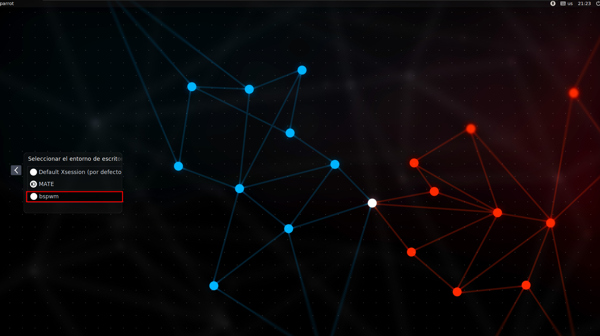
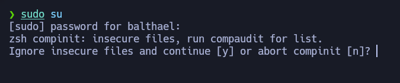
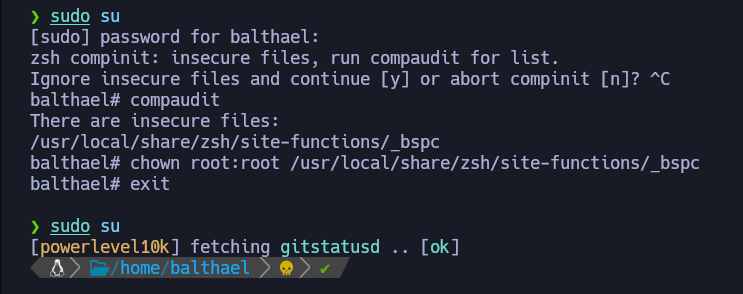

# Entorno de S4vitar en Parrot 100% Funcional


Bienvenidos a la guía de personalización del entorno de S4vitar en Parrot. Aquí encontrarás todos los pasos necesarios para una instalación completa y funcional.

## Video Tutorial

Puedes seguir el video tutorial paso a paso en mi [canal de YouTube](https://youtu.be/rY6S9CS6KDc). Si el contenido es de tu agrado, considera suscribirte y seguirme en [LinkedIn](https://www.linkedin.com/in/johnosoriob/).

Recuerda que este script esta diseñado para un sistema operavito Parrot en Español, si lo quieres en Ingles, cambia en el install.sh Descargas por Downloads.
## Instalación

Clona el repositorio y prepara la instalación con los siguientes comandos:

```bash
sudo apt update
sudo apt upgrade
#El sistema debe estar actualizado.
git clone https://github.com/Balthael/ParrotEntorno
cd ParrotEntorno
chmod +x install.sh
sudo ./install.sh
```

Después de la instalación, asegúrate de seleccionar BSPWM e instalar `fzf` y `nvim`, ya que no están incluidos en el script inicial.

 

### Problemas comunes

Si encuentras un error al cambiar al usuario root, sigue estos pasos para corregirlo:



Solución:

```bash
Ctrl + C
compaudit
chown root:root /usr/local/share/zsh/site-functions/_bspc
exit
```



### Instalación de fzf

Instalación para usuarios root y no privilegiados:

**Root:**

```bash
sudo su
```

```bash
git clone --depth 1 https://github.com/junegunn/fzf.git ~/.fzf
~/.fzf/install
```

**Usuario no privilegiado:**

```bash
git clone --depth 1 https://github.com/junegunn/fzf.git ~/.fzf
~/.fzf/install
```

### Ejecute este comando para evitar problemas en la zsh
- user=$(getent passwd $SUDO_USER | cut -d: -f6 | grep -oE '[^/]+$')
- sudo chsh -s $(which zsh) $user


### Instalación de Neovim

#### Para Usuario No Privilegiado:
Cada linea de comando por separado.

```bash
- Nos clonamos el NvChad como usuario no privilegiado `git clone https://github.com/NvChad/starter ~/.config/nvim`
- `sudo su` --->Nos convertimos en root 
- `cd` --->Para ir a la raíz
- `mkdir /opt/nvim`
- `cd /opt/nvim`
- `mv /home/balthael/ParrotEntorno/neovim/nvim-linux64 .` Movemos la carpeta nvim-linux64 que esta en el repositorio del entorno que clonamos  a la ruta creada.
- Nos cambiamos a usuario no privilegiado
- `cd /opt/nvim/nvim-linux64/bin `
- `sudo apt remove neovim`
- `./nvim` 
- `nvim`

```

#### Para Usuario Root:

```bash

- `sudo su` ---> Para volvernos root
- `cd /root/.config/` ---> Ir a la carpeta raíz de root
- `cp -r /home/balthael/.config/nvim .` ---> Copiamos de forma recursiva la carpeta nvim 
- `cd /root/.config/nvim` ---> vamos a la ruta nvim 
- `nvim` ---> Ejecutamos nvim 

```
 Para quitar el $ de nvim ver el video y agregar estas dos lineas en options.lua

```bash
Como root vamos a la ruta /root/.config/nvim/lua
y agregamos estas dons lineas en el archivo:
local o = vim.o
o.list =false

De igual manera para el usuario no privilegiado: 

Como usuario no privilegiado vamos /home/<su_usuario>/.config/nvim/lua
y agregamos estas dons lineas en el archivo:
local o = vim.o
o.list =false
```

Atajos (Personalización de entorno en Linux)

| Combinación           | Acción                                   |
| --------------------- | ---------------------------------------- |
| `Windows + Enter`     | Abrir Terminal                           |
| `Windows + Q`         | Cerrar Terminal                          |
| `Windows + D`         | Abrir Rofi                               |
| `Windows + Esc`       | 'Aplicar' la configuración               |
| `Windows + Shift + R` | Recargar Entorno                         |
| `Windows + Shift + Q` | Volver a la pantalla de bloqueo          |
| `Esc + Esc`           | Sudo                                     |
| `Ctrl + Alt + Mouse`  | Seleccionar copiar/pegar en modo Columna |
| `Windows + Shift + X` | Bloquear Entorno                         |

#### 🔹 Polybar

|Combinación|Acción|
|---|---|
|`Windows + 1 - 0`|Desplazamiento por ventanas|
|`Windows + Shift + 1 - 0`|Enviar el proceso actual a otra ventana de trabajo|

#### 🔹 Preselectores

|Combinación|Acción|
|---|---|
|`Windows + Ctrl + Alt + Flechas`|Abrir Preselector|
|`Windows + Ctrl + Alt + Espacio`|Cerrar Preselector|
|`Windows + Ctrl + 1 - 0`|Cambiar tamaño del Preselector|
|`Windows + Ctrl + M`|Seleccionar proceso y enviarlo a un Preselector nuevo|
|`Windows + Y`|Aplicar proceso previamente seleccionado|

#### 🔹 Terminal

|Combinación|Acción|
|---|---|
|`Windows + S`|Ejecutar Terminal de forma Ventana Flotante (Screen Floating)|
|`Windows + F`|Ejecutar Terminal de forma Pantalla Completa (Full Screen)|
|`Windows + T`|Ejecutar Terminal de forma Encajada (Terminal)|
|`Windows + Click Izquierdo`|Mover la ventana flotante (Mouse)|
|`Windows + Click Derecho`|Ampliar o reducir el tamaño de la ventana (Mouse)|
|`Windows + Ctrl`|Mover ventana flotante (Atajo)|
|`Windows + Alt`|Ampliar o reducir el tamaño de la ventana (Atajo)|
|`Windows + Shift + Flechas`|Intercambiar terminal de Izquierda/Derecha/Arriba/Abajo|

#### 🔹 Kitty

|Combinación|Acción|
|---|---|
|`Ctrl + Shift + Enter`|Abrir terminal o múltiples|
|`Ctrl + Shift + W`|Cerrar terminal|
|`Ctrl + Shift + R`|Ampliar o reducir tamaño de la terminal (T=Arriba S=Abajo)|
|`Ctrl + Shift + T + número`|Nueva pestaña/etiqueta|
|`Ctrl + Shift + Alt + T`|Renombrar|
|`Ctrl + Shift + Alt + , / .`|Desplazamiento por pestañas (Signo coma o punto)|

#### 🔹 FZF

|Combinación|Acción|
|---|---|
|`Ctrl + R`|Buscar por el Historial (utiliza Flechas para desplazarte)|
|`wh Ctrl + T`|Te mueves por lo que hayas escrito anteriormente (`escribes wh`)|
|`cd ** Ctrl + T`|Buscar directorios (`escribes cd**`)|
|`rm Ctrl + T`|Seleccionas con TAB archivos a eliminar y con ENTER aceptas (`escribes rm`)|

---

## Contacto

Si tienes preguntas o necesitas ayuda, no dudes en escribirme a mi [LinkedIn](https://www.linkedin.com/in/johnosoriob/).

Gracias

